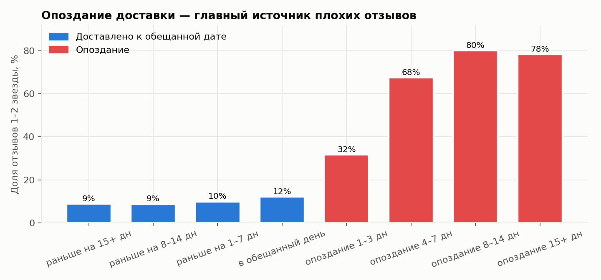
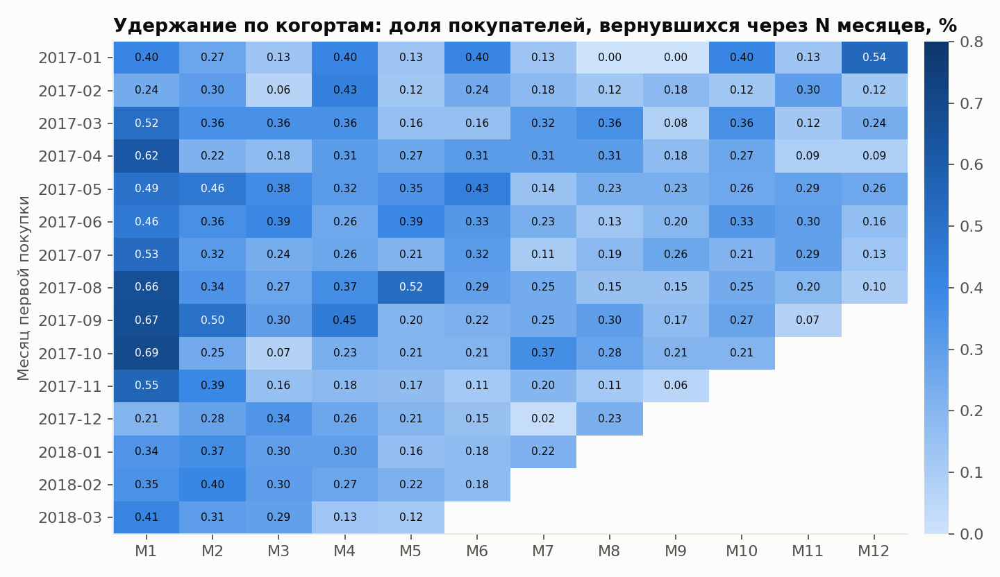
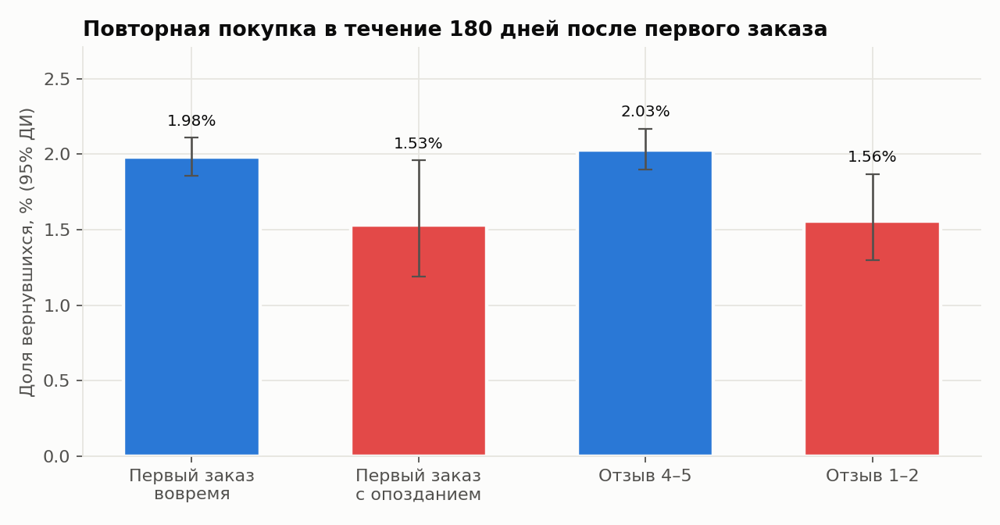
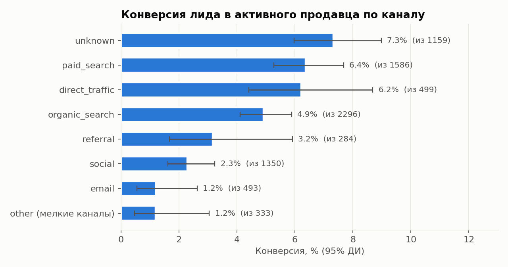
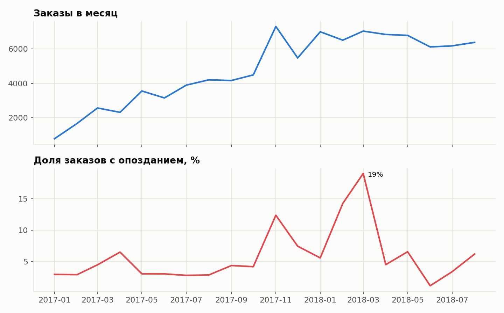

# Продуктовая аналитика маркетплейса Olist

Анализ 99 тыс. заказов бразильского маркетплейса Olist (2016–2018) и 8 тыс. лидов привлечения продавцов. Три бизнес-вопроса:

1. **Что портит оценки покупателей** и где это исправлять.
2. **Возвращаются ли покупатели** и влияет ли на это опыт первого заказа.
3. **Какие каналы приводят продавцов**, которые действительно начинают продавать.

Стек: PostgreSQL (витрины на SQL, оконные функции), Python (pandas, SciPy, statsmodels), Yandex DataLens.

**[Интерактивный дашборд в DataLens →](https://datalens.yandex/isqsplrx839e1?_share_link=public)**

## Главное

| Вывод | Цифры |
|---|---|
| Опоздание доставки — главный источник плохих отзывов | Доля отзывов 1–2★: **62,3%** при опоздании против **9,1%** при доставке в срок; разница 53 п.п. (95% ДИ 51,9–54,4), p < 0,001 |
| Проблема не в среднем сроке, а в хвосте | Заказ в среднем приходит на **11,9 дня раньше** обещанной даты, но **6,7%** опаздывают. Пики: ноябрь 2017 (12%) и март 2018 (**19%**) |
| Опоздания сосредоточены в отдельных штатах | Рио-де-Жанейро — второй рынок (12 тыс. заказов) с **12,1%** опозданий против 4,5% в Сан-Паулу; на северо-востоке (MA, CE, BA) — 12–18% |
| Покупатели почти не возвращаются | **97%** покупают один раз; через месяц возвращается **0,47%** когорты, через год — 0,06% |
| Плохой первый опыт снижает возврат, но не объясняет низкое удержание | Повторная покупка за 180 дней: 1,56% после отзыва 1–2★ против 2,03% после 4–5★. С учётом штата, категории, чека и квартала OR = **0,80** (95% ДИ 0,64–0,99, p = 0,04). Само опоздание после тех же поправок незначимо: OR = 0,91 (0,68–1,22). Без поправок разница 1,53% против 1,98% (p = 0,048) объясняется тем, что опаздывают заказы в штатах с более низким возвратом. Даже при хорошем опыте возвращаются только 2% |
| Каналы привлечения продавцов различаются в 5 раз | Лид становится продавцом с продажами в **4,75%** случаев: платный поиск — 6,4%, прямой трафик — 6,2%, соцсети — 2,3%, email — 1,2% (χ² = 71, p < 0,001) |
| Выручка размазана по категориям | 80% выручки дают 17 из 71 категории; крупнейшая (health & beauty) — 9,4% |

## Рекомендации

1. **Сделать долю опозданий по штату ключевой метрикой логистики** и увеличивать запас в обещанной дате для RJ и северо-востока в пиковые месяцы. Если бы RJ опаздывал как SP, это примерно 930 опозданий и около 490 плохих отзывов меньше за период. Оценка грубая: она предполагает, что опоздание — причина плохого отзыва.
2. **Не ждать большого роста удержания от улучшения доставки.** Недовольные покупатели возвращаются на четверть реже, но даже довольные возвращаются лишь в 2% случаев: проблема в отсутствии повода вернуться. Проверить A/B-тестом реактивацию на 30-й день, начиная с сегмента «Новые крупные» (22 тыс. покупателей, 5,2 млн BRL выручки). Недовольным после 1–2★ отдельно предложить компенсацию.
3. **Перераспределить бюджет привлечения продавцов** из соцсетей и email в поиск. Сначала нужно добавить стоимость лида по каналам: без неё сравнивается только конверсия, а не окупаемость.

## Графики











[Дашборд в DataLens](https://datalens.yandex/isqsplrx839e1?_share_link=public) построен по выгрузкам из [`marts/`](marts), инструкция — [docs/datalens.md](docs/datalens.md).

## Как устроен проект

```
sql/00_schema.sql     схема raw: таблицы один в один с CSV, ключи и ограничения
sql/01_load.sql       загрузка CSV
sql/02_quality.sql    14 проверок качества → reports/quality.txt
sql/10_marts.sql      витрины mart: заказ, когорты, месячные KPI, категории, доставка, воронка продавцов, RFM
analysis/analyze.py   проверка гипотез и графики → reports/results.json, reports/figures
marts/*.csv           агрегаты для дашборда
run.sh                весь прогон одной командой
```

Что показывает SQL: оконные функции (`row_number`, `lead`, `first_value`, накопленная сумма для Парето, `ntile` для RFM), когорты через `age()`, условная агрегация `FILTER`, `DISTINCT ON`, `percentile_cont`.

Методы: z-тест двух долей и доверительный интервал Ньюкомба для разницы, интервалы Уилсона, U-критерий Манна — Уитни, χ², логистическая регрессия с контролем смешивающих факторов, расчёт минимального обнаруживаемого эффекта.

## Запуск

Данные — в [data/README.md](data/README.md). Затем:

```bash
./run.sh
```

Нужны PostgreSQL 15+ (по умолчанию путь Postgres.app, другой задаётся `PGBIN`) и Python 3.11+. Зависимости ставятся в `.venv` автоматически.

## Ограничения

- **Данные — версия набора Olist из учебного курса, а не оригинал с Kaggle.** Позиций 111 тыс. против 112,6 тыс. Закрытых сделок 380 против 842: остались только продавцы, у которых были продажи, поэтому воронка измеряет «лид → продавец с продажами». У 2 185 заказов нет позиций, они исключены. Все расхождения — в [reports/quality.txt](reports/quality.txt).
- **Данные наблюдательные.** Связь опоздания с отзывом очень сильная, но это не эксперимент. Для решений по удержанию нужен A/B-тест.
- Оценки оставили не все покупатели. Повторные покупки считаются по `customer_unique_id` в окне 180 дней для первых заказов с 2017-01 по 2018-03.

---
Автор — Никита Джахнаев, Telegram [@snnvw](https://t.me/snnvw). Учебно-портфолио проект, 2026.
